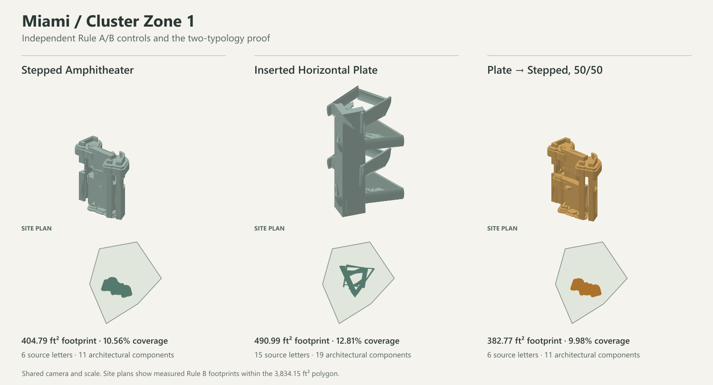

# Miami Zone 1 architectural review

The 50% Inserted Horizontal Plate / 50% Stepped Amphitheater study occupies **382.77 ft² of the 3,834.15 ft² permitted polygon**, or **9.98%**. It leaves 3,451.38 ft² open. A full-zone assignment gives the generator permission to use the polygon. The 40% building-coverage target remains a separate evaluation objective.

[Open the local three-study comparison](http://127.0.0.1:3064/experiment/site-polygon-morphogenesis?method=hybrid-rule&compare=1#site-generation-methods). In a fresh local browser, use checkpoint recovery before generating a new study. The three archived comparisons can be viewed immediately. In **Architectural display**, choose **Architecture Only** for the finished mesh or **Combined** for the source letters and the architecture together.

## Generation methods

| Method | What the percentage controls | Verified scope |
| --- | --- | --- |
| Typology Area Distribution | Available polygon area assigned to each typology | The existing allocator handles a Miami Gallery / Plate / Stepped 40/30/30 split with both the area and geometry strategies. Each independent architecture still requires a compatible territory, field and native profile. |
| Hybrid Rule Distribution | The distance each Stepped lift moves toward a same-level Plate perimeter station | One versioned, directional Plate-to-Stepped pair, in the original Miami Cluster Zone 1. The 25/75 and 50/50 ratios generate different architecture. |
| Descriptor-Based Distribution | Available polygon area assigned to each descriptor | All five descriptors have comparable scores for these two controls. Occupied source area within each region determines the local rule mixture for each lift. |

The existing Integrated, Adjacent and Vertical controls organize separate typology instances in Site Development. The new controls act on source geometry before architectural formation. Site handoffs, coordinated placement and the historic independent studies remain separately selectable. Combining the three new method inputs in a single request requires a future adapter.

## What the pair does

The versioned adapter replays the seed-39 Plate perimeter stations against the saved independent Plate control. It registers both native coordinate frames in site feet. For each of the three seed-69 Stepped lifts, it finds the nearest Plate station at the same level and translates the entire lift toward it by the requested proportion. The original L/U/V solids, yaw, sizes, within-lift spacing and 15-ft level spacing are retained. Native Stepped Rule B then rebuilds the walls, transitions and openings from those modified letter poses.

The 50/50 run moved the lowest, middle and highest lifts **2.87, 1.43 and 3.58 ft**. At 25% Plate influence each displacement halved, and the finished footprint changed to **393.72 ft²**. The record identifies each source letter, donor station, station and lift coordinates, level, rule versions, weights and native source hashes.

| Miami Zone 1 study | Source letters | Architectural components | Building footprint | Zone coverage |
| --- | ---: | ---: | ---: | ---: |
| Independent Stepped Amphitheater | 6 | 11 | 404.79 ft² | 10.56% |
| Independent Inserted Horizontal Plate | 15 | 19 | 490.99 ft² | 12.81% |
| 50% Plate / 50% Stepped | 6 | 11 | 382.77 ft² | 9.98% |

The combined study has two L, two U and two V sources. The finished mesh has 5,170 triangles, one connected solid and a maximum height of 33.56 ft above datum. Its street-region footprint is 39.46 ft² under a 60-ft cap. The intermediate region accounts for 343.30 ft² under a 40-ft cap. The study occupies zero area in the 20-ft water region. Measured area above a cap, outside the permitted boundary or inside a protected region was zero. Independent controls retain their original historical validation scope.

## Descriptor evidence

The cohort uses the complete, exported site-coordinate Rule B geometry of both independent studies. Each OBJ is matched to its archived mesh by vertices, face indices and hash. Evaluations v3.3 uses the same feet, Y-up orientation and 2-ft voxel size for both. Its absolute numeric scores pass through the existing Site Development percentage normalization. Stored profiles and ordinal rankings stay in their existing workflow.

| Descriptor | Independent Stepped score | Independent Plate score | Derived Plate influence |
| --- | ---: | ---: | ---: |
| Open Volume | 54.05 | 65.85 | 54.92% |
| Visually Connected | 16.22 | 28.29 | 63.56% |
| Circulation Activated | 87.90 | 81.06 | 47.98% |
| Vertically Integrated | 98.61 | 45.00 | 31.33% |
| Centralized | 84.35 | 91.25 | 51.96% |

The remainder in each row is the Stepped contribution. Each single-descriptor, full-zone case generated and replayed. The mixed **45% Open Volume / 55% Centralized** case allocated **1,725.37 / 2,108.78 ft²** along the site X axis. Generated source geometry occupied **89.94 / 84.87 ft²** of those regions. The resulting architecture occupied **381.18 ft²**. The requested **40% Open Volume / 35% Visually Connected / 25% Centralized** case stopped because one region had no source letters to carry its influence. The recorded scores describe the independent controls. A target descriptor score for the finished hybrid has yet to be established.

## Reuse and changed files

The implementation reuses the existing polygon and protected-area model, area-based polygon sweep, organizing fields, site-to-typology/v1 handoff, Roadways/Water envelope validator, Site Development weight normalization and quota system, native Rule A/B bindings, Evaluations scoring, authenticated generation endpoint, IndexedDB and publication/recovery stores. Each comparison opens the existing architecture viewer with the saved mesh and source-to-component links.

| Files, relative to the repository root | Change |
| --- | --- |
| `scripts/site-rule-influence.cjs`, `scripts/generate-design.cjs`, `scripts/stepped-design.cjs` | Versioned direction and ratio, native formation, input checks, spatial contributions, height validation and deterministic replay |
| `scripts/measure-hybrid-cohort.cjs`, `scripts/test-site-rule-influence.cjs` | Reproducible Evaluations cohort and milestone regressions |
| `src/components/polygonExperiment/cutArea.ts`, `territories.ts` in the same directory | Share the existing polygon sweep between territory and descriptor allocation |
| `descriptorInfluence.ts`, `hybrid-cohort.json`, `DescriptorProfiles.tsx` in that directory | Verified score mapping and distinction from manually stored profiles |
| `GenerationMethods.tsx`, `Studio.tsx`, `OrientationPanel.tsx`, `orientationStore.ts`, `OrientationView.tsx`, `orientationPresentation.ts`, `ArchitectureLayer.tsx` in that directory | Method selection, controls, results, comparison, cameras, section and validation display |
| `src/components/siteDevelopment/SiteDevelopmentStudio.tsx`, `next.config.ts` | Link from coordinated site placement and include worker dependencies in the deployment build |
| `public/experiment-designs/miami-plate-stepped-v1/` | New orientation, native architectural OBJ and site-coordinate architectural OBJ |
| `public/experiment-architecture/` | New architecture record `826148d5…` and orientation manifest `ba035ab1…` |
| `docs/miami-hybrid-proof.md`, `docs/miami-hybrid-comparison.png` | Review report and comparison drawn from the saved meshes |

The starting commit was `d8c15e0ec4317c8b1a5fc5f228399afef1b164fe`. The 50/50 architectural geometry SHA-256 is `12e41ce1a54565dd721512c7909ece4d29d8c672368089d1243fe1e81003356a`.

## Validation

- The new regression reconstructs the independent Stepped source and architecture hashes, remeasures both independent descriptor controls, checks area allocation, compares the two manual ratios, exercises all five descriptors and the spatial split, and checks rejection paths.
- All 15 source collision pairs passed for the hybrid. The native formation and export checks found one connected solid, zero unresolved intersections and valid OBJ geometry. The saved Rule A hash matches the input consumed by Rule B. Two isolated generator runs produced matching source and finished mesh hashes. Both source and finished geometry passed the complete permitted domain and local height tests.
- The shared site contract, shared site rules and Miami checkpoint integrity checks passed, including 26 authentic source bindings, 18 archived orientation records and 13 existing architecture files. The 24 Evaluations tests passed. The application type-check and local production build passed.
- A fresh browser on a protected local production build restored the Miami checkpoint and rejected an unauthenticated generation request. The authenticated UI generated and saved both new methods, restored the last result after reload, checked all three published IDs and the unpublished Stepped proof, opened both independent controls and the hybrid, and exercised perspective, orthographic plan and elevation, and a clipped section. Lattice, Evaluations and Composition also opened in that session.
- The new code is local to the development branch. Verification of these changes on the existing Vercel Preview follows an approved push.

## Five-typology blockers and next milestone

| Typology | Boundary of verified participation |
| --- | --- |
| Inserted Horizontal Plate | Can supply native same-level perimeter stations. A Plate Rule B receiving edge and a cross-typology joint remain to be verified. |
| Stepped Amphitheater | Can receive Plate source-position influence in the saved three-level Miami configuration. Other fields, sites and elevation profiles require their own validation. |
| Linear Edge Gallery | Has independent generation. Participation requires a versioned rule relationship, matched levels and a measured control in the same evaluation cohort. |
| Room Within Volume | The saved experimental wall proof requires a verified site-generation profile and a compatible connection before it can participate. |
| Void Field | A live site adapter still needs to demonstrate containment, native void preservation and compatible source relationships. |

The first proof establishes a source-arrangement relationship. A joint formed by both typologies' native Rule B operations remains open. The next milestone is **one source-linked Plate edge bearing on a Stepped platform or wall** in this same zone. Record the two source IDs, level alignment, measured contact area and clearance around the opening. Accept the joint after replay, connectivity, collision, containment, local height and both OBJ export checks pass. Extend participation to a third typology after that joint can be reproduced.
