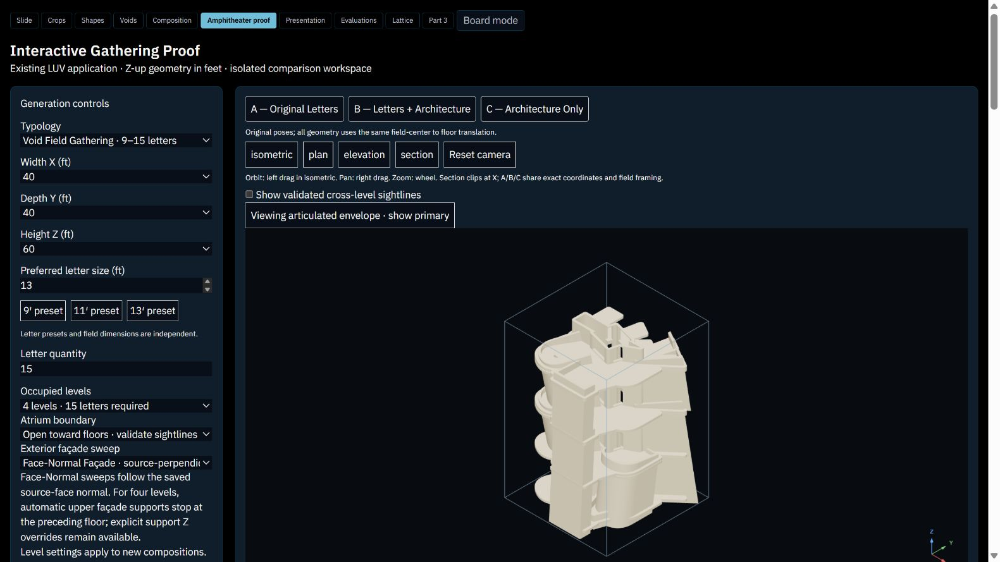
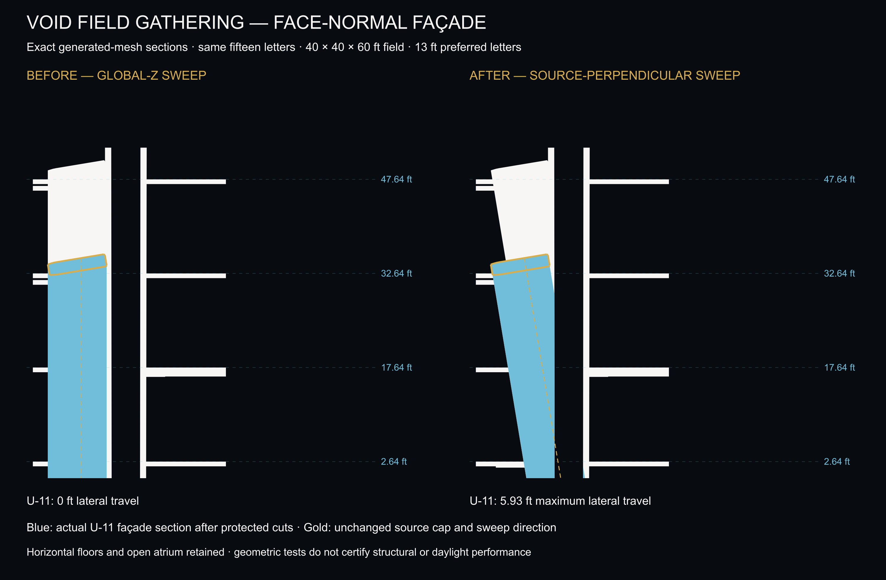
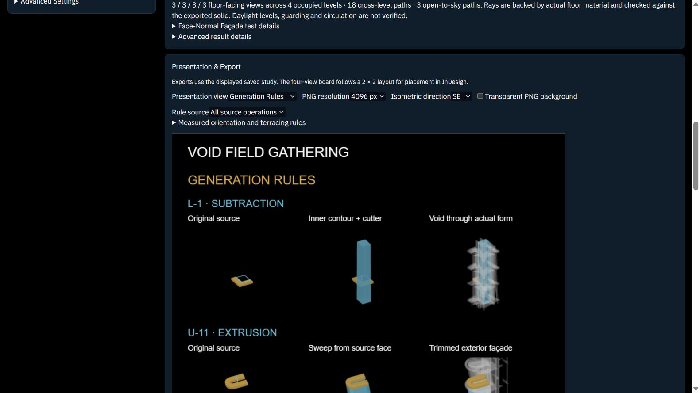

# Four-level Face-Normal correction

The reported four-level study 44abffe5-966f-4e12-8a0e-c8970f0d5dba retained facadeMode vertical. Its walls followed global Z despite tilted sources. This was a saved-mode mismatch. The existing analytic Face-Normal construction engine was not replaced.

Applying the normal sweep all the way to ground initially failed: copied upper sources created overlapping parallel shells and enclosed cavities. In four-level Face-Normal mode, automatic supports for upper copied sources now stop at the preceding floor underside (31.89 ft). Explicit support Z overrides still take precedence. Three-level behavior and vertical comparison remain unchanged. No validation thresholds were relaxed. The rejected ground-sweep log is retained.

## Actual application result

http://127.0.0.1:4201/amphitheater?study=c1fbdb4a-6f45-4b98-86d3-0255b7fdab01

Regenerated through the application using Facade sweep -> Face-Normal -> Regenerate Architecture. All 15 complete source records and letter meshes exactly match the original study. Its architecture exactly matches the geometry-test output. Original and corrected studies are both retained. The field remains 40 x 40 x 60 ft, preferred letters 13 ft, four occupied floors at 15-ft spacing.

## Geometry evidence

The section plane contains U-11's source normal and global Z. Gold is the actual source cap, blue the final facade section, white the final architecture. U-11 shifts laterally 5.93 ft along its source-normal direction. All nine perimeter facades independently pass normal-direction and actual mesh slice tests. Field boundary clipping caps and interior void boundaries have their own directions; they are not source-normal facade sweep faces. An arbitrary global X section need not display the full slope.

All four floor solids are geometrically identical before and after; tops are 2.64, 17.64, 32.64 and 47.64 ft. Original lower facades retain previous positive floor contacts; upper facades contact floors 3 and 4. Protected void cutters contain zero final material within existing tolerance. One connected exported material solid remains inside the field. Each letter retains at least 1 square foot of exposed contribution.

Volume: 9122.88073155914 cubic feet. Triangles: 18224. Strict self-intersections: 0 across 915616 non-adjacent checks. Existing legacy diagnostic flags: 371, retained. Atrium: three floor-facing views per floor, 18 cross-level paths across all six floor pairs, three sky paths; 231 independently checked exported-triangle rays are clear. These are geometric checks, not certified daylight, structural, guarding or circulation performance.

## Validation and scope

All 13 envelope regression suites passed, TypeScript --noEmit passed, targeted ESLint passed, and production build passed. New suite: scripts/four-level-face-normal-tests.cjs. Exact section producer: scripts/four-level-face-normal-section.cjs. Portable before/after requests: proof/fixtures/four-level-face-vertical.json and proof/fixtures/four-level-face-normal.json.

Files changed for this correction: scripts/source-void-field.cjs; scripts/envelope-regression-tests.cjs; src/components/AmphitheaterStudio.tsx; src/components/amphitheaterInteractiveTypes.ts; src/components/amphitheaterPresentationExport.ts; docs/ENVELOPE_EXPERIMENT.md; proof/fixtures/envelope-studies.json; the two portable requests, new test/section scripts and this report folder. Existing uncommitted Inserted Plate, population, four-level and presentation work is preserved.

Checkpoint 9c01558f11ff8ea7824f640f108fb588d9198b6a remains unchanged. No commit, push, merge or deployment was performed. Saved vertical studies remain vertical until intentionally regenerated in Face-Normal mode. Further edited arrangements may still fail connectivity, cavity or sightline validation; rejection remains explicit.

## Extrusion rule presentation update

Generation Rules now shows one actual void operation alongside a source-to-facade extrusion sequence. Gold is the unchanged source; blue shows the recorded sweep and final cut facade, over translucent actual architecture. Arrows use the saved source-face normal and roof-to-support traces. Captions report the selected facade support elevation and rule. Rule source now includes perimeter letters as well as interior void sources; the combined view chooses the facade with the greatest recorded plan shift for legibility. The same diagram appears in the four-view board and high-resolution PNG export.

Checked in the running application for combined operations and U-14 individual extrusion. TypeScript, targeted ESLint, OBJ/PNG export tests and production build passed. No generator, source letters or saved meshes were changed by this presentation update.

